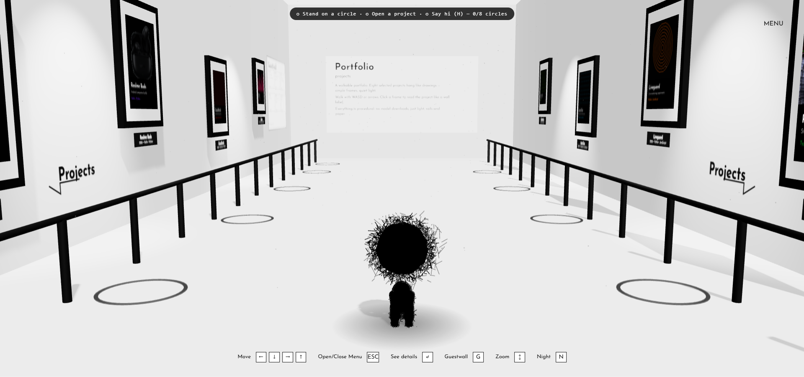
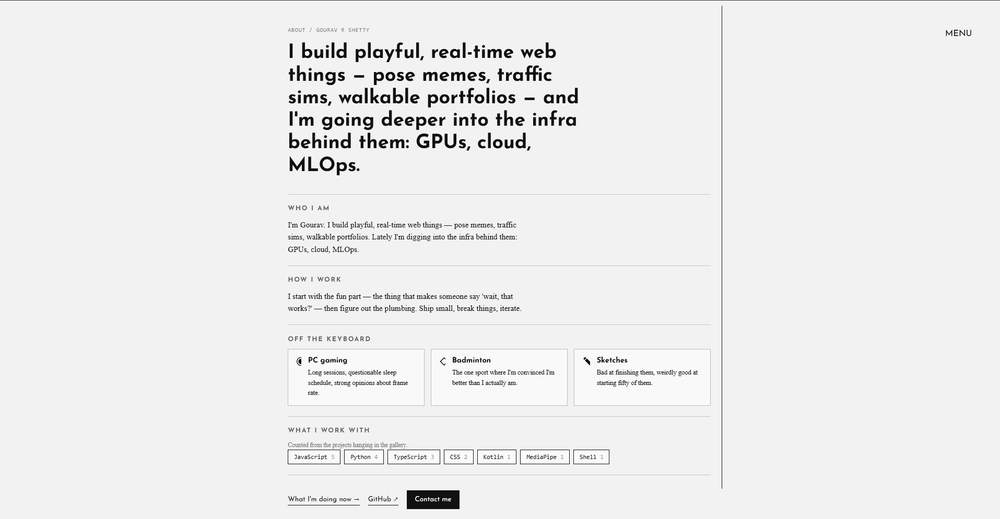
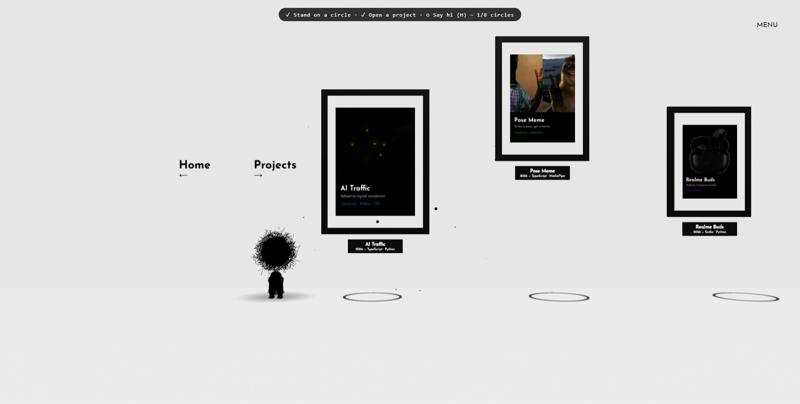
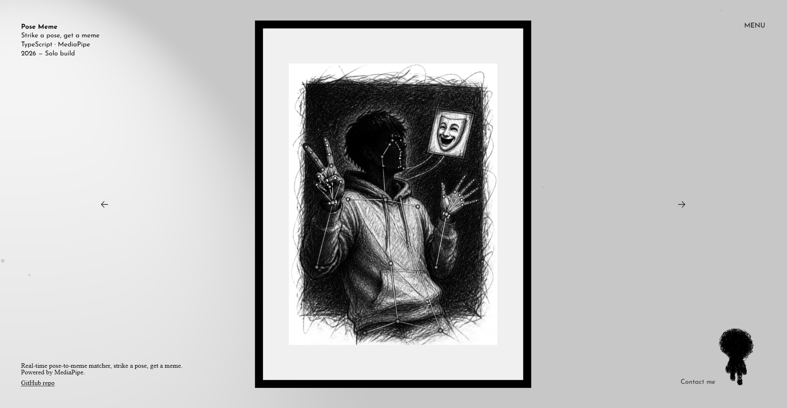
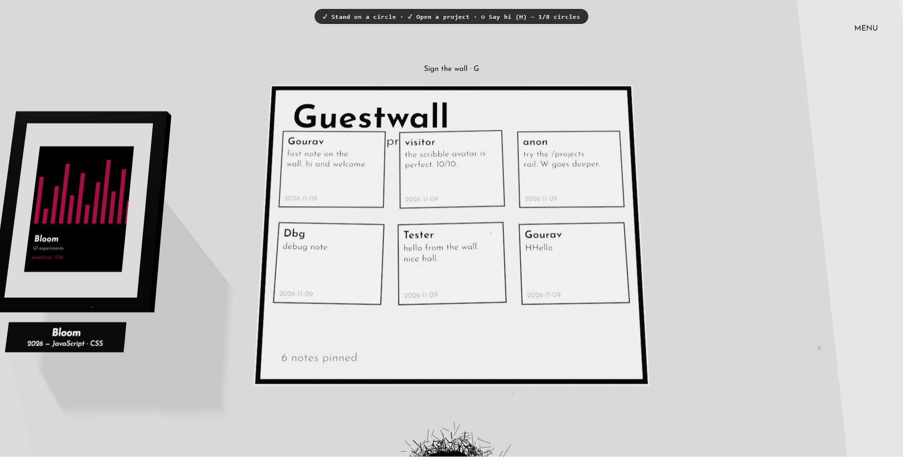

# Gourav R Shetty — walkable portfolio

A 3D portfolio you walk through. Eight projects hang like drawings in a quiet white gallery; stand on a circle to see one up close, then open its page. There's a long exhibition rail, a guestwall you can sign, an About page, and a living Now page.



## See it

| | |
|---|---|
| **Home hall** | eight frames, standing circles, ink footprints, night mode |
| **Opening sequence** | the hall starts dark; a light finds the avatar, then each part of the story |
| **Projects rail** | a long single-wall exhibition you walk end to end |
| **Project pages** | the artwork fills the view, with the story beside it |
| **Guestwall** | pin a note on the wall; notes stay in your browser |
| **About / Now** | who I am, what I work with, what I'm learning |





## Run it

```sh
npm install
npm run dev       # open the printed URL
npm test          # checks the content files and app wiring
npm run build     # production build in dist/
```

Requires Node 18+. No API keys or backend.

## Make it yours

1. **`public/data/projects.json`** — up to eight projects. Each entry has a `uid`, `title`, `tagline`, `stack`, `year`, `role`, `description`, `link`, `linkLabel`, optional `image`/`shot`, `color`, `pattern`.
2. **`public/data/about.json`** — your name, one-liner, intro, how you work, hobbies.
3. **`public/data/now.json`** — what you're learning, building, into, and open to.
4. **`src/main.js`** — contact email and GitHub link.
5. **`public/models/avatar.glb`** — optional avatar model (gitignored; keep your own copy locally). Without it, the gallery still runs.

The skills block on `/about` is counted from `projects.json` automatically — no second list to maintain.



## Controls

| Desktop | Phone |
|---|---|
| `WASD` / arrows to walk | on-screen joystick, analog speed |
| Click a frame or press `Enter` on a circle | tap **See details** or a frame |
| `Esc` from a project → back to the circle | back button or the arrow controls |
| `N` night shift, `H` replay intro, wheel to zoom | on-screen `N`, `H`, zoom buttons |
| `Menu` button or `Esc` | `MENU` button |

The deep end of the home hall walks you into `/projects`; either end of the rail walks you home.

## Opening sequence

On the first home load the hall starts dark. A small light finds the avatar, then moves on to the frames, the skills, and what's next — WHO, WHAT, HOW, NOW — with one short line at each stop. The hall fills with light at the end and you can walk.

Tap anywhere or press `Esc` to skip at any point; `H` replays it. Visitors who prefer reduced motion go straight to a fully lit hall with no captions. The sequence uses the site's existing lights and ink styling — no assets, no audio.

## Structure

```
index.html                shell, loader, menu, canvas
src/main.js               boot: load JSON → scene → router → tick
src/pages.js              home / rail / project / about / now / 404 templates
src/core/Router.js        SPA routes + ink transitions
src/core/Menu.js          fullscreen menu, search, breadcrumbs
src/world/Gallery.js      rooms, frames, rings, dust, lights
src/world/Character.js    avatar, walking, camera, input
src/world/coverTexture.js procedural covers and plaques
src/core/skills.js        stack counts from projects.json
src/intro/chapters.js     chapter copy + intro state machine (pure)
src/intro/overlay.js      scrim, moving cut-out, captions
public/data/*.json        all editable content
tests/                    content + routing + controller tests
```

## Guestwall

Press `G` on a walk page (or tap the wall's circle) to pin a note. Notes are stored in `localStorage` in the visitor's browser; nothing is uploaded.



## Deploy

Static site. `npm run build` produces `dist/`; any static host works. `vercel.json` enables deep links by rewriting requests to `index.html`.

Built with Three.js, GSAP and Vite.
